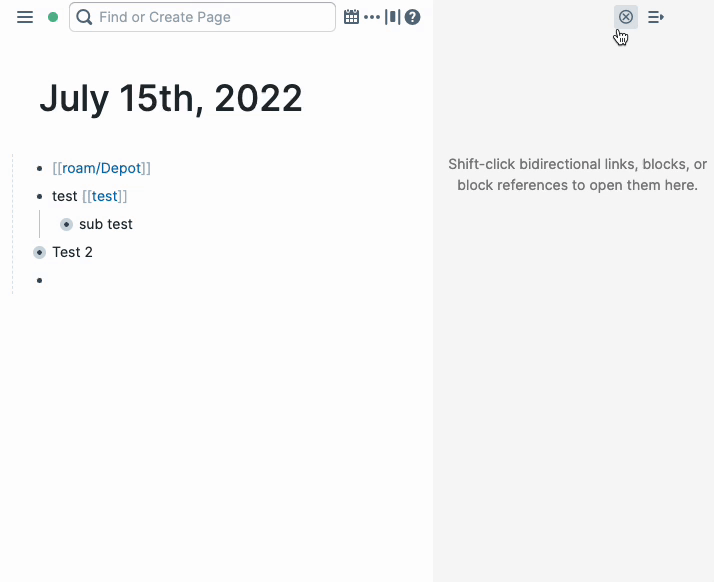

# Clear Sidebar
Adds a button to the top of the right sidebar to clear and close all blocks and pages in the sidebar. A customizable keyboard shortcut can also be set.

Cleared too much? Run **Clear Sidebar: Undo Last Clear** from the command palette (you can give it a hotkey in Roam's settings) to bring back the windows from the most recent clear. Undo is kept in memory only, so it does not survive a reload.

## Example 
  </img>
